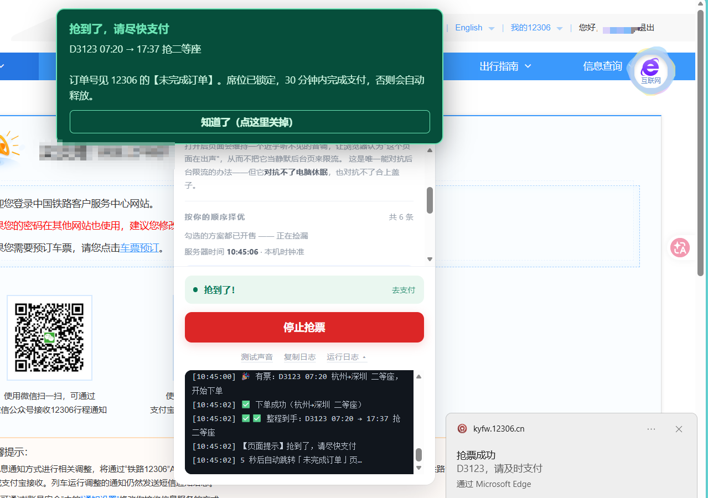
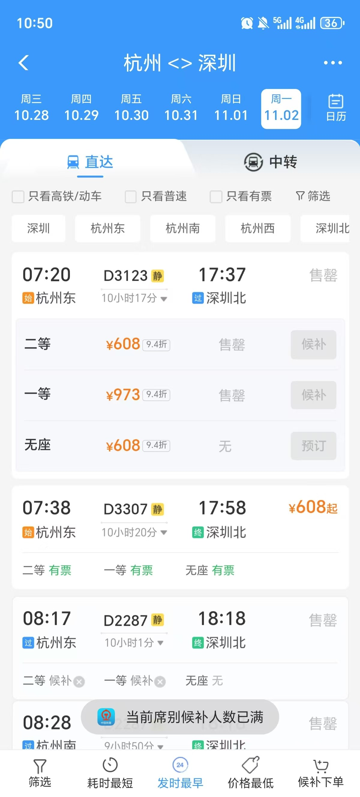

<p align="center">
  
</p>

<h1 align="center">12306 抢票助手 Pro</h1>

<p align="center">
  <b>填条件 → 看方案 → 按顺序抢。</b><br>
  一个跑在浏览器里的 12306 抢票脚本：不装软件、不填账号密码，所有请求都在你自己的浏览器里完成。
</p>

<p align="center">
  <a href="https://black-mouse-sha.github.io/12306-ticket-assistant-pro/12306-ticket-assistant-pro.user.js"></a>
  <a href="LICENSE"></a>
  <a href="https://www.tampermonkey.net/"></a>
</p>

<p align="center">
  <a href="docs/USAGE.md">完整使用手册</a> ·
  <a href="docs/ARCHITECTURE.md">架构与实现</a> ·
  <a href="https://black-mouse-sha.github.io/12306-ticket-assistant-pro/">在线架构图</a> ·
  <a href="#常见问题">常见问题</a>
</p>

---

> [!WARNING]
> **抢票时地址栏必须是 `kyfw.12306.cn`。**
> `www.12306.cn`（首页、会员中心）可以查票，但下单会被 12306 拒绝。v3.3.4 起脚本会直接拦住你，不让你等到开售那一秒才发现。
>
> 最稳的入口：**12306 → 车票 → 单程**（`kyfw.12306.cn/otn/leftTicket/init`），或个人中心（`kyfw.12306.cn/otn/view/index.html`）。

## 长什么样

| 桌面端：抢到票 | 手机端：开售 5 分钟售罄 |
|:---:|:---:|
|  |  |
| 面板挂在 12306 页面上，抢到后页面弹窗 + 系统通知 | 杭州 → 深圳 D3123，开售 5 分钟全部售罄——正是脚本要抢的场景 |

> 两张图均为真实使用截图，姓名、头像、订单号已打码。

## ⚡ 30 秒上手

### 1. 装油猴

给浏览器装 **Tampermonkey**（油猴）扩展：<https://www.tampermonkey.net/>

Chrome / Edge / Firefox 都支持。

### 2. 装脚本

**点这里一键安装**：

**<https://black-mouse-sha.github.io/12306-ticket-assistant-pro/12306-ticket-assistant-pro.user.js>**

油猴会弹出安装页，点「安装」即可。

> 这个链接由 GitHub Pages 提供，国内网络一般可以直接打开。
> 如果打不开，打开 [GitHub 文件页](https://github.com/black-mouse-sha/12306-ticket-assistant-pro/blob/main/12306-ticket-assistant-pro.user.js)，点右上角的 **Raw** 按钮。

<details>
<summary>如果点击没有反应 / 想手动安装</summary>

1. 点开油猴图标 → 「管理面板」→「+」新建脚本；
2. 把仓库里的 [`12306-ticket-assistant-pro.user.js`](12306-ticket-assistant-pro.user.js) 全文复制进去；
3. 按 `Ctrl + S` 保存；
4. 打开 `kyfw.12306.cn` 任意页面，右上角出现面板，版本号 **v3.3.5** 就成功了。

</details>

### 3. 打开正确的页面

登录 12306，然后进入 **车票 → 单程**：

```
https://kyfw.12306.cn/otn/leftTicket/init
```

面板出现在页面右上角。如果没出现，刷新一下页面。

### 4. 三步开抢

| 步骤 | 你做什么 | 脚本做什么 |
|:---:|---|---|
| **① 条件** | 选日期、填出发/到达站、勾席别、勾乘车人 | 自动保存配置，下次打开还在 |
| **② 方案** | 点「下一步」，勾选/删除/拖动排序查回来的真实车次 | 真去查一遍票，标出票价、余票、起售时间 |
| **③ 抢票** | 点「开始抢票」 | 按你的顺序、按各站起售时刻自动开火；抢到后弹窗 + 通知，跳转支付页 |

> **第一次用，建议先只点「下一步」。** 这一步纯粹查票，不会下任何单，零风险。确认方案和起售时间都对，再点「开始抢票」。

## 它凭什么比手动快

- **按起售时刻开火**：起售时间按「乘车站」算，中转两段通常不同。脚本支持多个起售点，各自到点开火，不用你守着。
- **服务器时钟校准**：用 12306 响应头里的 `Date` 校准本机时钟，误差按毫秒算，不靠你电脑准不准。
- **三类方案一起抢**：直达、买长乘短、中转接力，按你排的顺序择优；整程到手就全停，中转第 1 段到手先催你付款，同时继续盯第 2 段。
- **跨域也不卡死**：同源走 `fetch`，跨域直接走油猴的 `GM_xmlhttpRequest`（没有 OPTIONS 预检），每个请求都有看门狗超时。
- **被限流会自己慢下来**：遇到 12306 拒绝会退避，不会头铁硬刷；登录失效、有未完成订单会自动停。
- **状态不丢**：接力状态、订单提醒、运行日志都落盘，刷新/跳转回来还认得自己是谁。

## 功能一览

| 能力 | 说明 |
|---|---|
| 直达 / 买长乘短 / 中转 | 三种方案统一列表，按勾选顺序择优 |
| 多起售点 | 每个乘车站一个开火时刻，中转两段各等各的 |
| 预约抢票 | 预售期外的日期也能先设好，到点自动查票开火 |
| 自动候补 | 没票时可自动提交候补订单 |
| 选座 | 靠窗 / 过道 / 挨着，也能直接在车厢图上点座位号 |
| 同城车站 | 接受同城其它车站，避免「上海→杭州」漏掉虹桥/杭州东 |
| 学生票 | 勾乘车人旁的「学」标记，自动带学生票参数 |
| 静音车厢 | 支持静音车厢车次筛选 |
| 提醒 | 页面弹窗 + 系统通知 + 声音；跨时段接力可保持唤醒 |
| 日志 | 面板日志说人话，技术日志可一键复制；报错自动展开 |

## 工作原理（30 秒版）

```text
你填条件
   ↓
查票（leftTicket/query + queryByTrainNo）
   ↓
按起售时刻排队 → 到点轮询余票
   ↓
下单 5 步：submitOrderRequest → checkOrderInfo → getQueueCount
           → confirmSingleForQueue → 跳转支付
   ↓
抢到：停止 / 弹窗 / 通知；中转：落盘接力状态，继续等第 2 段
```

所有请求都从你的浏览器直接发往 `kyfw.12306.cn`，脚本没有自己的服务器，也不会上传账号、密码、身份证、乘车人信息。

更细的模块边界、请求通道、状态机和下单时序，看：

- [架构与实现说明](docs/ARCHITECTURE.md)
- [在线架构图（6 张交互图）](https://black-mouse-sha.github.io/12306-ticket-assistant-pro/)
- [完整使用手册](docs/USAGE.md)

## 已知限制（都是真的，不是没做完）

| 限制 | 说明 |
|---|---|
| **不能替你付款** | 12306 没有开放支付接口。抢到后只能提醒你，付款必须自己在页面上点，**30 分钟内**完成。 |
| **只能抢 kyfw 域名** | `www.12306.cn` 上查票可以，下单会被 12306 拒绝，脚本会直接拦住。 |
| **中转要选明天以后** | 12306 的接续换乘对「当天出发」一律返回无方案，不是脚本坏了。 |
| **预约只抢直达** | 预约场景只抢一张票、不下车；中转 / 买长乘短要等进了预售期再用正常流程。 |
| **商务座 / 优选一等座不给选座** | 不同车型座位字母排布不同，猜错会让整单被判非法参数，交给系统分配。 |
| **买长乘短要核对经停站** | 依赖 `/otn/czxx/queryByTrainNo`；接口拿不到时脚本会放行并在日志里警告。 |
| **一次「下一步」要 5~12 个请求** | 12306 正好限流时可能查不全，过一会儿再点一次。 |

## 常见问题

<details>
<summary><b>按钮上写「还差：加载乘车人」怎么办？</b></summary>

先看日志最后一行：

- `Failed to fetch` / 超时 → 跨域被拦，确认脚本是最新版，并尽量在 `kyfw.12306.cn` 页面使用；
- 「请求成功了，但没返回乘车人」→ **没登录**，登录后点「重新加载」。
</details>

<details>
<summary><b>点「下一步」一条中转都没有？</b></summary>

12306 的接续换乘**不支持当天出发**。把出行日期选到**明天以后**，中转方案就会回来。直达和买长乘短不受影响。
</details>

<details>
<summary><b>为什么在 www.12306.cn 上点「开始抢票」被拒绝？</b></summary>

12306 的 `submitOrderRequest` 会检查请求来源。从 `www.12306.cn` 发过去补不上它要的 Referer，会返回 HTML 错误页。脚本 v3.3.4 起直接拦截，避免你到点才发现。换到 `kyfw.12306.cn` 的任意页面即可。
</details>

<details>
<summary><b>一直显示「正在查询 12306…」？</b></summary>

- 先确认版本是 **v3.3.5**（旧版没有跨域兜底和看门狗）；
- 12306 可能在限流，等十几秒再点一次；
- 打开右下角「运行日志」，看最后一行报错。
</details>

<details>
<summary><b>会被 12306 封号吗？</b></summary>

脚本做了退避、熔断和请求频率控制，但**不能保证**。任何自动化工具都有被风控的可能，请自己权衡风险，不要多账号、不要商业代抢。因使用产生的后果由使用者自行承担。
</details>

<details>
<summary><b>脚本会上传我的信息吗？</b></summary>

不会。脚本没有服务端，所有配置、日志、接力状态都存在油猴的本地存储里；网络请求只发往 `kyfw.12306.cn` / `www.12306.cn`。
</details>

## 项目结构

```text
.
├─ 12306-ticket-assistant-pro.user.js   # 全部逻辑：单文件、无构建、无依赖
├─ index.html                            # GitHub Pages 入口：安装按钮 + 架构图
├─ README.md                             # 你正在看的快速上手
├─ CHANGELOG.md                          # 版本与改动记录
├─ LICENSE                               # MIT
└─ docs/
   ├─ USAGE.md                           # 完整使用手册（每个按钮、每条报错）
   ├─ ARCHITECTURE.md                    # 架构、请求通道、状态机、下单时序
   ├─ ANDROID-PLAN.md                    # 安卓 App 改造方案（设计稿，未实现）
   ├─ diagrams/                          # 6 张自包含交互式架构图
   └─ images/                            # 截图（已打码）与图标
```

## 工程笔记（给面试官 / 维护者）

- **单文件、零依赖**：约 4,700 行原生 JavaScript，没有框架、没有打包步骤，`Ctrl+S` 就能改。
- **一次有边界的重构**：从上游 v2.1.17 的单一定时、整条联程链路，改成「三步界面 + 多起售点 + 中转两段接力 + 状态落盘」，并删掉了维护成本最高的联程链路。
- **双通道请求层**：同源 `fetch` 与跨域 `GM_xmlhttpRequest` 自动切换，配合 `AbortController` 看门狗，解决 12306 边缘节点不回 OPTIONS 预检导致的「一直查询」。
- **时间与节奏**：用响应头校准服务器时钟、按乘车站生成多个起售点、热窗口内自适应轮询、失败退避与熔断。
- **可观测性**：面板日志 + 技术日志双轨，落盘可跨页面恢复，报错自动展开，一键复制。
- **文档即交付物**：完整手册 + 6 张交互式架构图（节点标注源码行号）+ 安卓改造方案，图表与源码逐行对应。
- **真实场景验证**：2026-10-17 在个人中心页面下出真实订单；2026-10-19 预约 11-02 杭州 → 深圳 D3123 并抢票成功（截图见上）。

## 作者

**LittlePerson** · [GitHub @black-mouse-sha](https://github.com/black-mouse-sha)

如果这个项目帮你抢到了票，欢迎点一个 ⭐ Star；有问题可以开 [Issue](https://github.com/black-mouse-sha/12306-ticket-assistant-pro/issues)。

## 致谢

- 原版脚本：[12306 抢票助手 Pro v2.1.17](https://scriptcat.org/zh-CN/script-show-page/6106)，作者 **辻弌20**，MIT License。
- 本项目基于原版重构 v3 系列，保留原作者的 MIT 许可与署名。

## 免责声明

本项目仅供**学习与个人研究**使用，与 12306 官方无关，不是官方产品。

请遵守 [12306 用户协议](https://www.12306.cn/) 与相关法律法规，合理设置查询频率，**不要用于商业代抢、倒票或多账号刷票**。脚本按「现状」提供，不保证长期可用；因使用本项目产生的任何后果由使用者自行承担。

## License

[MIT](LICENSE) © 2026 辻弌20（原版）· LittlePerson（v3 重构与文档）
